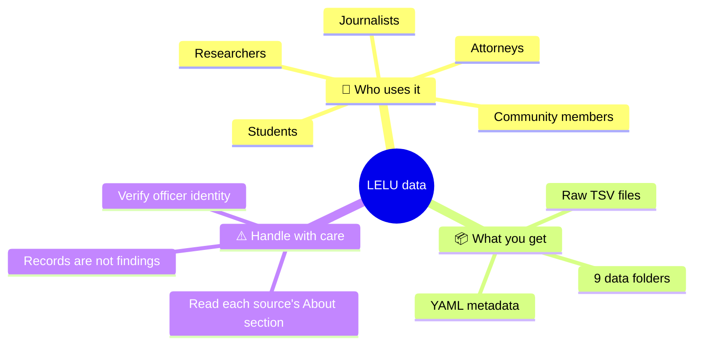
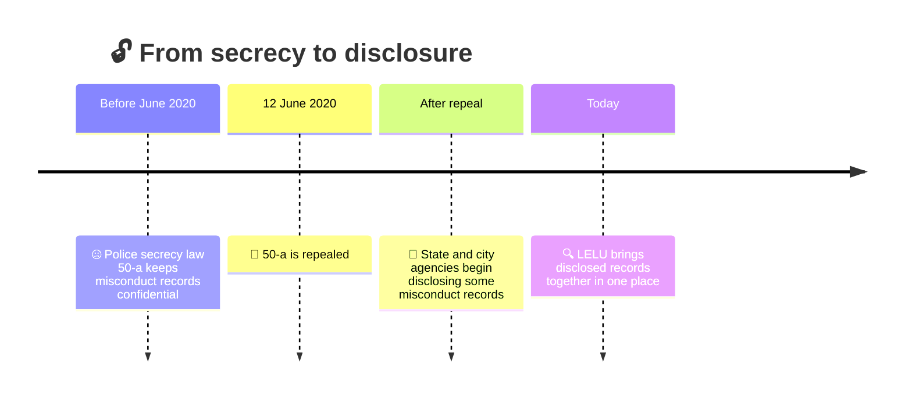
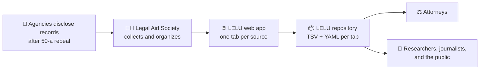
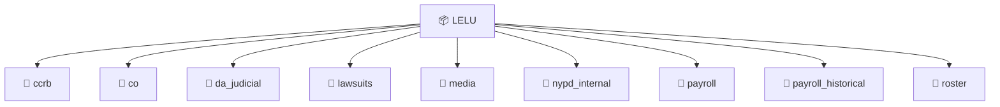
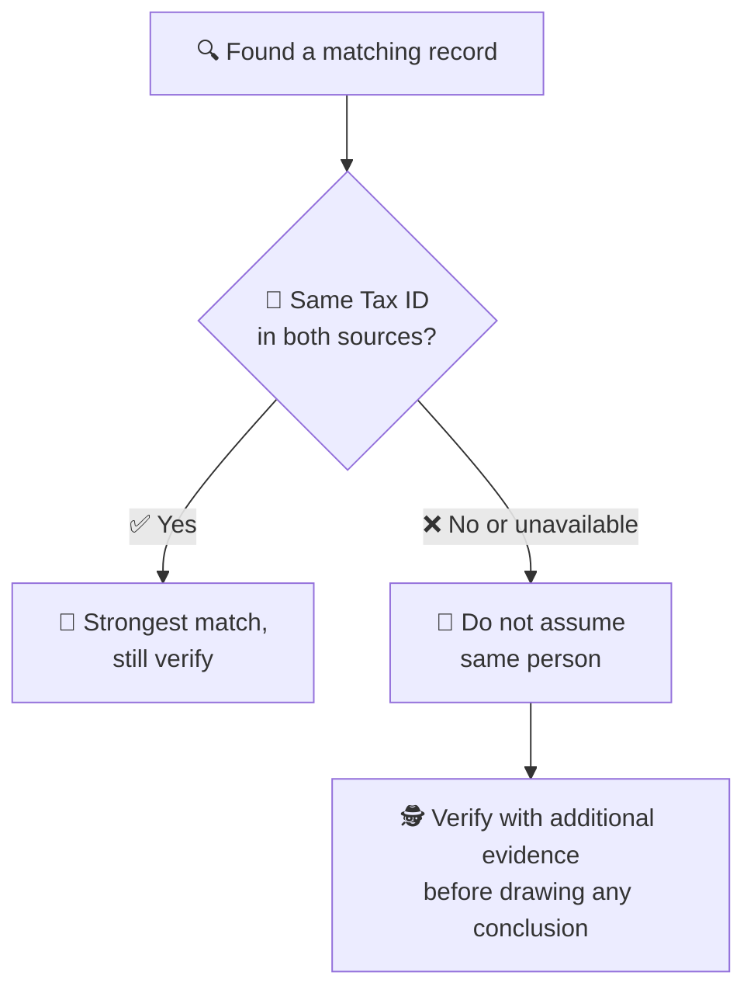
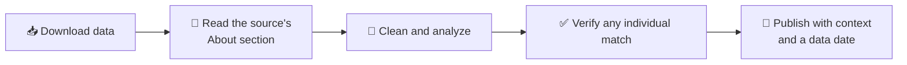

<div align="center">

# ⚖️🗽 LELU: Law Enforcement Lookup Data 🗽⚖️

### 🔍 Raw, machine-readable law enforcement misconduct data for New York City 🏙️

**📣 Data from [The Legal Aid Society of NYC](https://legalaidnyc.org)** · 🌐 [Live LELU app](https://legaidsoc.shinyapps.io/cap_search/) · ℹ️ [About LELU](https://legalaidnyc.org/law-enforcement-look-up/) · 🍴 [Upstream repo](https://github.com/the-legal-aid-society/LELU)


</div>

---

> 🍴 **This is a fork.** The original, authoritative repository is [`the-legal-aid-society/LELU`](https://github.com/the-legal-aid-society/LELU), maintained by The Legal Aid Society. This fork adds documentation and example code. For the most current data, sync from or use the upstream repository.

---

## 📖 Table of Contents

1. [👀 At a glance](#-at-a-glance)
2. [❓ What is this?](#-what-is-this)
3. [🎁 Benefits](#-benefits)
4. [🗓️ Why it exists: the repeal of 50-a](#️-why-it-exists-the-repeal-of-50-a)
5. [🧭 About the data](#-about-the-data)
6. [🗂️ What's in each folder](#️-whats-in-each-folder)
7. [🚀 How to use this repo](#-how-to-use-this-repo)
8. [📊 Visualizing the data](#-visualizing-the-data)
9. [🧪 Validating and profiling](#-validating-and-profiling)
10. [📚 Data dictionary template](#-data-dictionary-template)
11. [🪪 Identifying officers responsibly](#-identifying-officers-responsibly)
12. [⚠️ Limitations and caveats](#️-limitations-and-caveats)
13. [🧑‍⚖️ Responsible use](#️-responsible-use)
14. [🔄 Keeping your copy up to date](#-keeping-your-copy-up-to-date)
15. [📝 Citing this data](#-citing-this-data)
16. [🤝 Support and contributions](#-support-and-contributions)
17. [📜 License and terms](#-license-and-terms)
18. [🔤 Glossary](#-glossary)
19. [🙋 FAQ](#-faq)
20. [🙏 Credits](#-credits)

---

## 👀 At a glance

|                         |                                                                                                              |
| ----------------------- | ------------------------------------------------------------------------------------------------------------ |
| 🏛️ **Data from**        | The Legal Aid Society of NYC                                                                                 |
| 🎯 **Original purpose** | Support NYC LAS attorneys representing clients; shared with the public as a courtesy 🤲                      |
| 📁 **Format**           | One folder per LELU tab, each with `.tsv` data and `.yml` metadata                                           |
| 🗃️ **Folders**          | `ccrb`, `co`, `da_judicial`, `lawsuits`, `media`, `nypd_internal`, `payroll`, `payroll_historical`, `roster` |
| 🔄 **Updates**          | Upstream is updated each time LELU is updated                                                                |
| 🛠️ **Support level**    | Limited (see [Support](#-support-and-contributions))                                                         |



---

## ❓ What is this?

**Law Enforcement Lookup (LELU)** provides one-stop access to law enforcement misconduct data in New York City 🗽. It brings together many kinds of misconduct records that were historically hidden, so they can be searched in one place.

This repository holds the **raw data behind LELU** 📦. Each folder corresponds to one tab of the LELU app and contains:

| 📄 File type | 🎯 Purpose                                                                    |
| ------------ | ----------------------------------------------------------------------------- |
| `.tsv`       | The data itself, tab-separated, easy to load into Excel, R, Python, SQL, etc. |
| `.yml`       | Metadata describing the corresponding dataset                                 |

> 🎯 **Primary purpose of the original database:** to support NYC Legal Aid Society attorneys in representing their clients. It is shared with the public as a courtesy.

---

## 🎁 Benefits

| 🎁 Benefit                     | 💬 What it means for you                                                                       |
| ------------------------------ | ---------------------------------------------------------------------------------------------- |
| 📦 **Many sources, one place** | Complaint, court, lawsuit, media, internal, payroll and roster data side by side               |
| 🧰 **Easy to use**             | Plain text files that open in Excel, Google Sheets, Python, R, SQL and DuckDB. No login or API |
| 🔓 **Transparency**            | Records that were secret until 50-a was repealed in 2020                                       |
| 🕰️ **Trackable history**       | Git history shows how the data changed between updates                                         |
| 🆓 **Free to access**          | No paywall and no special software                                                             |
| 🧪 **Great for projects**      | Research, journalism, courses, dashboards and civic-tech work                                  |
| 🏷️ **Documented**              | Each dataset ships with `.yml` metadata                                                        |

---

## 🗓️ Why it exists: the repeal of 50-a

For decades, New York's police secrecy law, **Civil Rights Law § 50-a** 🤐, kept law enforcement misconduct records shrouded in secrecy and withheld from the public. After **50-a was repealed on June 12, 2020** 🎉, state and city agencies began disclosing some misconduct records.

LELU exists to make those many forms of records accessible in one place 🧩, giving the public information needed to help achieve meaningful accountability ⚖️.



---

## 🧭 About the data

The data comes from **publicly disclosed records** about law enforcement in New York City, compiled and organized by The Legal Aid Society 🧑‍⚖️. A large share concerns the **NYPD** 👮, but different folders draw on different sources.

> 📌 **Provenance matters.** Each LELU tab has an **About** section on the [LELU site](https://legalaidnyc.org/law-enforcement-look-up/) describing where its data came from. Read it, along with the folder's `.yml` file, before relying on or republishing a dataset. The underlying records originate with the agencies that disclosed them.



---

## 🗂️ What's in each folder

Each folder matches a LELU tab. The descriptions below are based on the folder names; **always confirm in the folder's `.yml` files and the LELU About sections**.

| 📁 Folder            | 🧾 Likely contents (from the name)                            |
| -------------------- | ------------------------------------------------------------- |
| `ccrb`               | Records related to the Civilian Complaint Review Board        |
| `co`                 | See the folder's `.yml` and the LELU About section            |
| `da_judicial`        | Records connected to district attorneys and judicial findings |
| `lawsuits`           | Lawsuit-related records                                       |
| `media`              | Media-related records                                         |
| `nypd_internal`      | NYPD internal records                                         |
| `payroll`            | Payroll records                                               |
| `payroll_historical` | Historical payroll records                                    |
| `roster`             | Personnel roster records                                      |

```text
LELU/
├── 📄 README.md
├── 📁 ccrb/
├── 📁 co/
├── 📁 da_judicial/
├── 📁 lawsuits/
├── 📁 media/
├── 📁 nypd_internal/
├── 📁 payroll/
├── 📁 payroll_historical/
└── 📁 roster/
    └── each folder: 📊 *.tsv  +  🏷️ *.yml
```



---

## 🚀 How to use this repo

### 👀 1. Browse on GitHub

Open a folder, then click a `.tsv` file to preview the rows. Click a `.yml` file to read its metadata.

### 📥 2. Download

**No Git:** click the green **Code** button → **Download ZIP**.

**With Git:**

```bash
git clone https://github.com/PrajwalKoirala638/LELU.git  # download a full copy of this repository
cd LELU  # move into the downloaded repository folder
```

### 📊 3. Open in a spreadsheet

In Excel or Google Sheets, import the file as **tab-delimited** (Data → From Text/CSV, or File → Import).

### 🐍 4. Python (pandas)

```python
import pandas  # load the pandas library for working with tables

tsv_file_path = "ccrb/<dataset>.tsv"  # path to the data file (replace <dataset> with a real file name)

dataframe = pandas.read_csv(tsv_file_path, sep="\t", dtype=str)  # read the tab-separated file, keeping every column as text
print(dataframe.shape)  # print the number of rows and columns
print(dataframe.columns.tolist())  # print the list of column names
print(dataframe.head())  # print the first five rows as a preview
```

### 📈 5. R

```r
library(readr)  # load the readr library for reading delimited files
library(dplyr)  # load the dplyr library, which provides the glimpse() function

tsv_file_path <- "ccrb/<dataset>.tsv"  # path to the data file (replace <dataset> with a real file name)

dataframe <- read_tsv(tsv_file_path, col_types = cols(.default = "c"))  # read the tab-separated file, keeping every column as text
glimpse(dataframe)  # print a compact summary of the columns and first values
```

### 💻 6. Command line

```bash
find . -name "*.tsv"  # list every data file in this repository

tail -n +2 ccrb/<dataset>.tsv | wc -l  # count the data rows by skipping the header line and counting the rest

head -n 1 ccrb/<dataset>.tsv | tr '\t' '\n'  # print the header line with one column name per line
```

### 🦆 7. DuckDB (SQL on the raw files)

```sql
SELECT *  -- select every column
FROM read_csv_auto('ccrb/<dataset>.tsv', delim='\t', all_varchar=true)  -- read the tab-separated file with every column as text
LIMIT 10;  -- return only the first ten rows
```

### 🏷️ 8. Read the metadata

```python
import yaml  # load the PyYAML library for reading .yml files

metadata_file_path = "ccrb/<dataset>.yml"  # path to the metadata file (replace <dataset> with a real file name)

with open(metadata_file_path, encoding="utf-8") as metadata_file:  # open the metadata file as UTF-8 text
    print(yaml.safe_load(metadata_file))  # parse the YAML safely and print the resulting dictionary
```

> 💡 **Tip:** read identifier-like columns (IDs, tax IDs, shield numbers) **as text** so leading zeros are not dropped.

### ▶️ 9. Running the code examples

1. **Get the files** (see step 2) and open a terminal in the `LELU` folder, because every path in the examples is relative to it.
2. **Replace the placeholders.** Anything in angle brackets, such as `<dataset>`, `<folder>`, `<date-column>`, `<category-column>` and `<precinct-column>`, must be replaced with a real name. Run the "preview the columns" command in step 6 to see the real column names.
3. **Install what each language needs:**
   - 🐍 Python: `pip install pandas matplotlib seaborn pyyaml tabulate`
   - 📈 R: `install.packages(c("readr", "dplyr", "ggplot2"))`
   - 🦆 DuckDB: install from <https://duckdb.org>, then run `duckdb` in the `LELU` folder
4. **Run it:**
   - 🐍 Save a Python block as a file such as `example.py`, then run `python example.py`. Or paste it into a Jupyter notebook cell.
   - 📈 Paste the R block into R or RStudio, or save it as `example.R` and run `Rscript example.R`.
   - 💻 Paste each command-line line into your terminal (macOS, Linux, or Git Bash on Windows).
   - 🦆 Paste the SQL into the DuckDB prompt.
5. **Find your charts.** The chart examples save image files (such as `records_per_year.png`) in the folder you ran them from.


---

## 📊 Visualizing the data

📉 Counts change with every update, so this repo does not ship fixed statistics. These recipes generate charts from the current files, so the numbers are always accurate ✅. Replace the `<...>` placeholders with real names from the dataset you're using.

### 📅 Records per year

```python
import pandas  # load the pandas library for working with tables
import matplotlib.pyplot  # load the matplotlib plotting library

dataframe = pandas.read_csv("<folder>/<dataset>.tsv", sep="\t", dtype=str)  # read the tab-separated file, keeping every column as text

dataframe["year"] = pandas.to_datetime(dataframe["<date-column>"], errors="coerce").dt.year  # convert the date column to dates and keep only the year (bad dates become blank)
records_per_year_counts = dataframe["year"].value_counts().sort_index()  # count the records in each year and sort the years in order

records_per_year_counts.plot(kind="bar", figsize=(10, 4), title="Records per year")  # draw a bar chart of records per year
matplotlib.pyplot.xlabel("Year")  # label the horizontal axis
matplotlib.pyplot.ylabel("Records")  # label the vertical axis
matplotlib.pyplot.tight_layout()  # adjust spacing so labels are not cut off
matplotlib.pyplot.savefig("records_per_year.png", dpi=150)  # save the chart as an image file
```

### 🏷️ Top categories

```python
import pandas  # load the pandas library for working with tables
import matplotlib.pyplot  # load the matplotlib plotting library

dataframe = pandas.read_csv("<folder>/<dataset>.tsv", sep="\t", dtype=str)  # read the tab-separated file, keeping every column as text

top_category_counts = dataframe["<category-column>"].value_counts().head(15)  # count each category and keep the 15 most common
top_category_counts.sort_values().plot(kind="barh", figsize=(8, 6), title="Most common categories")  # draw a horizontal bar chart with the largest bar at the top
matplotlib.pyplot.tight_layout()  # adjust spacing so labels are not cut off
matplotlib.pyplot.savefig("top_categories.png", dpi=150)  # save the chart as an image file
```

### 🗺️ By precinct (R)

```r
library(dplyr)  # load dplyr for counting and filtering rows
library(ggplot2)  # load ggplot2 for drawing charts
library(readr)  # load readr for reading delimited files

dataframe <- read_tsv("<folder>/<dataset>.tsv", col_types = cols(.default = "c"))  # read the tab-separated file, keeping every column as text

dataframe |>  # start with the data and pipe it into the next step
  count(`<precinct-column>`, sort = TRUE) |>  # count records per precinct, largest first
  slice_head(n = 20) |>  # keep only the top 20 precincts
  ggplot(aes(reorder(`<precinct-column>`, n), n)) +  # set up the chart with precincts ordered by their counts
  geom_col() +  # draw one bar per precinct
  coord_flip() +  # turn the bars sideways so names are easy to read
  labs(x = NULL, y = "Records", title = "Records by precinct (top 20)")  # set the axis labels and chart title
```

### 🔥 Month-by-year heatmap

```python
import pandas  # load the pandas library for working with tables
import matplotlib.pyplot  # load the matplotlib plotting library
import seaborn  # load the seaborn library for drawing heatmaps

dataframe = pandas.read_csv("<folder>/<dataset>.tsv", sep="\t", dtype=str)  # read the tab-separated file, keeping every column as text

parsed_dates = pandas.to_datetime(dataframe["<date-column>"], errors="coerce").dropna()  # convert the date column to dates and drop rows with missing or bad dates
year_by_month_counts = (  # start building a table of counts with years as rows and months as columns
    pandas.DataFrame({"year": parsed_dates.dt.year, "month": parsed_dates.dt.month})  # make a small table holding each date's year and month
    .value_counts()  # count how many records fall in each year and month pair
    .unstack(fill_value=0)  # turn months into columns and fill empty cells with zero
    .sort_index()  # sort the rows by year
)  # finish building the table
seaborn.heatmap(year_by_month_counts, cmap="YlOrRd")  # draw the heatmap using a yellow-orange-red color scale
matplotlib.pyplot.title("Records by year and month")  # add a title to the chart
matplotlib.pyplot.savefig("heatmap.png", dpi=150)  # save the chart as an image file
```

### 🧩 Missing-data chart

```python
import pandas  # load the pandas library for working with tables
import matplotlib.pyplot  # load the matplotlib plotting library

dataframe = pandas.read_csv("<folder>/<dataset>.tsv", sep="\t", dtype=str)  # read the tab-separated file, keeping every column as text

missing_percentage_by_column = dataframe.isna().mean().sort_values(ascending=False).head(20) * 100  # find the share of blank cells per column as a percentage and keep the 20 highest
missing_percentage_by_column.plot(kind="barh", figsize=(8, 6), title="% missing by column")  # draw a horizontal bar chart of missing percentages
matplotlib.pyplot.tight_layout()  # adjust spacing so labels are not cut off
matplotlib.pyplot.savefig("missing.png", dpi=150)  # save the chart as an image file
```

### 💡 Ideas

- 📈 Trends over time
- 🗺️ Geographic breakdowns
- 🏷️ Category or outcome comparisons
- 🕳️ Where data is missing, and what that says about disclosure
- 🔗 Cross-folder comparison (see the caution on identifiers below)

---

## 🧪 Validating and profiling

### 📋 Profile every folder at once

```python
from pathlib import Path  # load Path for finding files on disk
import pandas  # load the pandas library for working with tables

profile_rows = []  # start an empty list that will hold one summary per file
for tsv_file_path in Path(".").rglob("*.tsv"):  # loop over every .tsv file in this folder and all subfolders
    dataframe = pandas.read_csv(tsv_file_path, sep="\t", dtype=str)  # read the file, keeping every column as text
    profile_rows.append({  # add one summary entry for this file
        "folder": tsv_file_path.parts[0],  # record the top-level folder the file lives in
        "file": tsv_file_path.name,  # record the file name
        "rows": len(dataframe),  # record how many rows the file has
        "columns": dataframe.shape[1],  # record how many columns the file has
    })  # finish the summary entry

summary_table = pandas.DataFrame(profile_rows).sort_values(["folder", "file"])  # combine all entries into a table sorted by folder, then file
print(summary_table.to_markdown(index=False))  # print the table in Markdown format (needs the tabulate package)
```

Paste the output below to keep a dated snapshot 📸:

| 📁 Folder   | 📄 File     | 🔢 Rows | 🧱 Columns | 📅 Snapshot date |
| ----------- | ----------- | ------: | ---------: | ---------------- |
| _generated_ | _generated_ |     _n_ |        _n_ | _YYYY-MM-DD_     |

### ✅ Sanity checks after each update

```python
from pathlib import Path  # load Path for finding files on disk
import pandas  # load the pandas library for working with tables

for tsv_file_path in Path(".").rglob("*.tsv"):  # loop over every .tsv file in this folder and all subfolders
    dataframe = pandas.read_csv(tsv_file_path, sep="\t", dtype=str)  # read the file, keeping every column as text
    assert dataframe.shape[1] > 1, f"{tsv_file_path}: only one column, check the delimiter"  # stop with a message if the file parsed into a single column
    print(f"{tsv_file_path}: {len(dataframe)} rows, {dataframe.duplicated().sum()} exact duplicate rows")  # print the row count and the number of fully duplicated rows
```

### 🤖 Optional: GitHub Actions summary

Save the profiling script as `scripts/profile.py`, then add `.github/workflows/profile.yml`:

```yaml
name: Profile data  # the name shown for this workflow in the GitHub Actions tab
on:  # define when the workflow runs
  push:  # run whenever commits are pushed
    paths: ["**/*.tsv"]  # only run when a .tsv file was changed
jobs:  # list the jobs in this workflow
  profile:  # a job named "profile"
    runs-on: ubuntu-latest  # run the job on the newest Ubuntu machine GitHub offers
    steps:  # list the steps of the job in order
      - uses: actions/checkout@v4  # download this repository's files onto the machine
      - uses: actions/setup-python@v5  # install Python on the machine
        with: { python-version: "3.12" }  # choose Python version 3.12
      - run: pip install pandas tabulate  # install the libraries the profiling script needs
      - run: python scripts/profile.py >> $GITHUB_STEP_SUMMARY  # run the script and add its output to the workflow run summary
```

---

## 📚 Data dictionary template

Copy this for each dataset 📝 and fill it in from the `.yml` file and the LELU About section.

| 🏷️ Column  | 🧾 Description  | 🔤 Type              | ❓ Can be blank? | 📝 Notes  |
| ---------- | --------------- | -------------------- | ---------------- | --------- |
| `<column>` | _what it means_ | text / date / number | yes / no         | _caveats_ |

**Per-dataset checklist** ✔️

- [ ] 🌐 Source agency and how the records were obtained
- [ ] 📅 Date range covered
- [ ] 🔄 Date of last refresh
- [ ] 🪪 Which officer identifiers are present (Tax ID, shield, name)
- [ ] ⚠️ Known gaps or quirks

---

## 🪪 Identifying officers responsibly

🧑‍⚖️ LELU users are responsible for determining whether the results returned represent the officer in question.

The misconduct sources vary in how much they identify each individual officer. For NYPD officers, **the only stable and unique identifier is the "Tax ID"** 🔑, and it is **not consistently available** from every source. These are **not** reliable identifiers:

| 🏷️ Field                 | 🎯 Reliable?   | 💬 Why                                 |
| ------------------------ | -------------- | -------------------------------------- |
| 🔑 Tax ID                | ✅ Most stable | Not present in all sources             |
| 🛡️ Shield / badge number | ⚠️ No          | Can change or be reassigned            |
| 🏢 Precinct / command    | ⚠️ No          | Officers transfer                      |
| 👤 Name                  | ⚠️ No          | Changes, duplicates, spelling variants |

This is why **LELU does not build a single "profile" page per officer** 🚫👤. Please do not merge records across folders by name or badge alone, and treat any match as a lead to verify, not a conclusion.



---

## ⚠️ Limitations and caveats

- 🧾 **Records are not findings.** A record's presence does not by itself establish what happened.
- 🧩 **Coverage is uneven.** Agencies disclosed records at different times and in different formats.
- 🚫 **No unified officer identity.** See the identifier section above.
- 🕳️ **Data reflects disclosure, not reality.** Missing records may simply mean nothing was disclosed.
- 🛑 **No adverse decisions about an individual** without independent verification.
- ⏳ **Forks and snapshots age.** Check the upstream repo and the LELU page for the latest data.

---

## 🧑‍⚖️ Responsible use



- 🤝 Present findings with context, not as standalone accusations
- 🔬 Be transparent about methods and limitations
- 🧍 Remember that real people appear in these records, including civilians

---

## 🔄 Keeping your copy up to date

This fork does not update itself. To pull the latest data from Legal Aid's repository:

```bash
git remote add upstream https://github.com/the-legal-aid-society/LELU.git  # register Legal Aid's original repository under the name "upstream"
git fetch upstream  # download the latest changes from upstream without applying them yet
git merge upstream/main  # merge the downloaded upstream changes into your current branch
```

Or use the **Sync fork** button on the GitHub page of your fork 🔄. The LELU site shows its own "last updated" date 📅.

---

## 📝 Citing this data

> The Legal Aid Society of NYC. _Law Enforcement Lookup (LELU)_. https://legalaidnyc.org/law-enforcement-look-up/. Accessed YYYY-MM-DD.

```bibtex
@misc{lelu,
  author       = {{The Legal Aid Society of NYC}},
  title        = {Law Enforcement Lookup (LELU)},
  howpublished = {\url{https://legalaidnyc.org/law-enforcement-look-up/}},
  note         = {Accessed: YYYY-MM-DD}
}
```

---

## 🤝 Support and contributions

🏗️ The Legal Aid Society does not have the organizational capacity to support full-stack application development, so it is limited in its ability to provide documentation or updates, make improvements, or collaborate with outside parties.

- 📚 For questions about the **data**, see the LELU site and the upstream repository.
- 🛠️ For questions about this fork's **documentation and example code**, open an issue here.
- 🙏 Please understand that issues and pull requests may not receive a response.

---

## 📜 License and Terms

⚖️ **MIT License**

This project is released under the **MIT License**, one of the most permissive open-source licenses.

- 📂 **Data:** The data was originally compiled and published by The Legal Aid Society of NYC. The MIT License applies only to original materials owned by this project's author. It does not automatically grant rights to third-party data. Please review the Legal Aid Society's [Terms of Use](https://legalaidnyc.org/terms-of-use/) and [Disclaimer](https://legalaidnyc.org/disclaimer/) before redistributing, modifying, or using the data commercially.

- 🧑‍💻 **Original code and documentation:** All original code, scripts, chart configurations, documentation, and README content created for this repository are licensed under the MIT License.

- 🚫 **Third-party content:** Data, materials, trademarks, and other content owned by third parties remain subject to their respective licenses, terms, and restrictions. The repository author does not claim ownership of or grant additional rights to such materials.

- 🤝 **Contributions:** Contributions to original project materials are subject to the MIT License unless otherwise specified.

See the [LICENSE](LICENSE) file for the complete license text.

---

## 🔤 Glossary

| 🔤 Term           | 💬 Meaning                                                                                 |
| ----------------- | ------------------------------------------------------------------------------------------ |
| **LELU**          | Law Enforcement Lookup, Legal Aid's tool for law enforcement misconduct data in NYC        |
| **50-a**          | New York Civil Rights Law § 50-a, the police secrecy law repealed on June 12, 2020         |
| **Tax ID**        | The only stable, unique identifier for NYPD officers, though not available in every source |
| **TSV**           | Tab-separated values, a plain-text table format                                            |
| **YAML (`.yml`)** | A human-readable format used here for dataset metadata                                     |
| **Fork**          | A personal copy of a GitHub repository                                                     |
| **LAS**           | The Legal Aid Society                                                                      |

---

## 🙋 FAQ

**🧐 Is this all NYPD data?**
Much of it concerns the NYPD 👮, but sources vary by folder. Check each folder's `.yml` and the LELU About sections.

**🔎 Can I search officers by name here?**
Use the [LELU app](https://legaidsoc.shinyapps.io/cap_search/) 🌐 for searching. This repository is for raw files.

**🗂️ Why TSV instead of CSV?**
Tabs rarely appear inside text fields, which makes parsing more robust than commas.

**⏱️ How do I know the data is current?**
Compare this fork's commits with the upstream repo, and check the "last updated" date on the LELU page 🕰️.

**🔗 Can I link records across folders?**
Only with great care. See the identifier section.

**🆘 I need legal help. Can you help?**
This repo can't give legal advice. Legal Aid's help line is **212-577-3300** 📞.

---

## 🙏 Credits

💙 Data compiled and published by **The Legal Aid Society**, New York City.

- 🌐 Website: <https://legalaidnyc.org>
- 🔍 LELU: <https://legalaidnyc.org/law-enforcement-look-up/>
- 🍴 Upstream repo: <https://github.com/the-legal-aid-society/LELU>
- 📞 Free legal help: call **212-577-3300**

<div align="center">

⚖️ _Transparency is critical to accountability._ ⚖️

</div>
