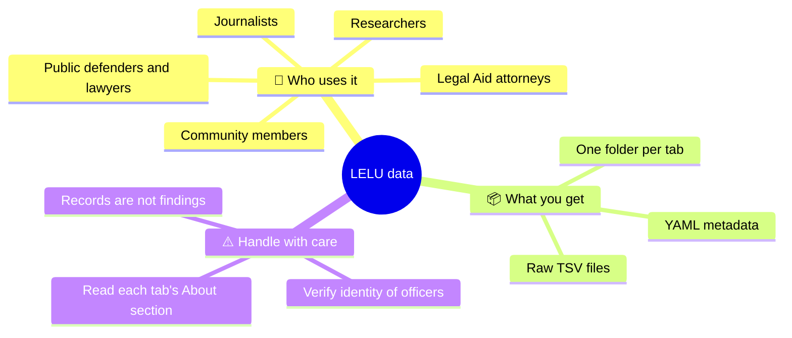
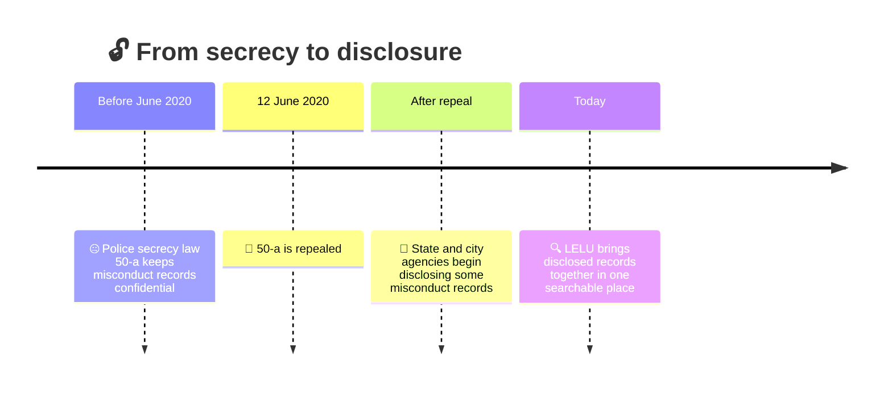
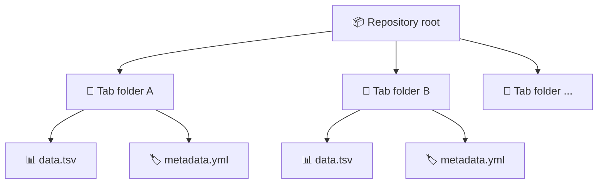
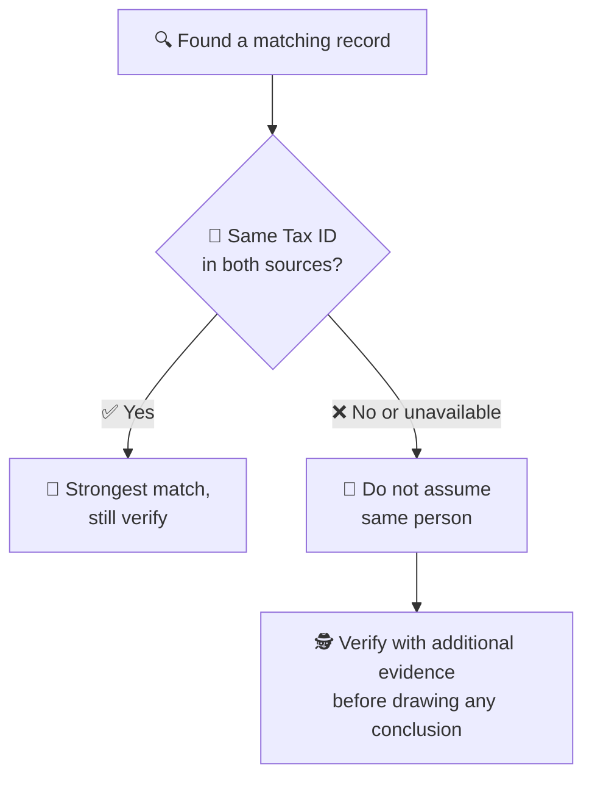
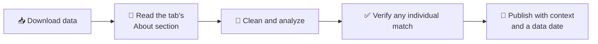

<div align="center">

# ⚖️🗽 LELU: Law Enforcement Lookup Data 🗽⚖️

### 🔍 Raw, machine-readable law enforcement misconduct data for New York City 🏙️

**📣 Published by [The Legal Aid Society of NYC](https://legalaidnyc.org)** · 🌐 [Live LELU app](https://legaidsoc.shinyapps.io/cap_search/) · ℹ️ [About LELU](https://legalaidnyc.org/law-enforcement-look-up/)


</div>

---

## 📖 Table of Contents

1. [👀 At a glance](#-at-a-glance)
2. [❓ What is this?](#-what-is-this)
3. [🗓️ Why it exists: the repeal of 50-a](#️-why-it-exists-the-repeal-of-50-a)
4. [🧭 About the data and where it comes from](#-about-the-data-and-where-it-comes-from)
5. [🗂️ Repository layout](#️-repository-layout)
6. [🚀 Quick start](#-quick-start)
7. [📊 Visualizing the data](#-visualizing-the-data)
8. [🧪 Validating and profiling the data](#-validating-and-profiling-the-data)
9. [📚 Data dictionary template](#-data-dictionary-template)
10. [🪪 Identifying officers responsibly](#-identifying-officers-responsibly)
11. [⚠️ Limitations and caveats](#️-limitations-and-caveats)
12. [🧑‍⚖️ Responsible use](#️-responsible-use)
13. [🔄 Update cadence](#-update-cadence)
14. [📝 Citing this data](#-citing-this-data)
15. [🤝 Support and contributions](#-support-and-contributions)
16. [📜 License and terms](#-license-and-terms)
17. [🔤 Glossary](#-glossary)
18. [🙋 FAQ](#-faq)
19. [🙏 Credits](#-credits)

---

## 👀 At a glance

|                      |                                                                                         |
| -------------------- | --------------------------------------------------------------------------------------- |
| 🏛️ **Publisher**     | The Legal Aid Society of NYC                                                            |
| 🎯 **Purpose**       | Support NYC LAS attorneys representing clients; shared with the public as a courtesy 🤲 |
| 📁 **Format**        | One folder per LELU tab, each with `.tsv` data and `.yml` metadata                      |
| 🔄 **Updates**       | Each time LELU is updated                                                               |
| 📍 **Coverage**      | Law enforcement misconduct records in New York City                                     |
| 🛠️ **Support level** | Limited (see [Support](#-support-and-contributions))                                    |



---

## ❓ What is this?

**Law Enforcement Lookup (LELU)** provides one-stop access to law enforcement misconduct data in New York City 🗽. It brings together many different kinds of misconduct records that were historically hidden, so they can be searched in one place.

This repository holds the **raw data behind LELU** 📦. Each folder corresponds to one tab of the LELU app and contains:

| 📄 File type | 🎯 Purpose                                                                    |
| ------------ | ----------------------------------------------------------------------------- |
| `.tsv`       | The data itself, tab-separated, easy to load into Excel, R, Python, SQL, etc. |
| `.yml`       | Metadata describing the corresponding dataset                                 |

> 🎯 **Primary purpose:** this database exists to support NYC Legal Aid Society attorneys in representing their clients. It is shared with the public as a courtesy.

---

## 🗓️ Why it exists: the repeal of 50-a

For decades, New York's police secrecy law, **Civil Rights Law § 50-a** 🤐, kept law enforcement misconduct records shrouded in secrecy and withheld from the public. After **50-a was repealed on June 12, 2020** 🎉, state and city agencies began disclosing some misconduct records.

LELU exists to make those many forms of records accessible in one place 🧩, giving the public information needed to help achieve meaningful accountability ⚖️.



---

## 🧭 About the data and where it comes from

This repository contains the data published through **The Legal Aid Society of NYC's Law Enforcement Lookup**. It is built from **publicly disclosed records** about law enforcement in New York City, compiled and organized by Legal Aid 🧑‍⚖️. A large share concerns the **NYPD** 👮, but LELU covers law enforcement misconduct data broadly, and different tabs draw on different sources.

> 📌 **Provenance matters.** Each LELU tab has an **About** section describing where its data came from and how it was obtained. Always read it before relying on or republishing a dataset. The underlying records originate with the agencies that disclosed them; Legal Aid compiles and shares them here.


---

## 🗂️ Repository layout

Folders map one-to-one to LELU tabs 🗃️. Illustrative structure:

```text
LELU/
├── 📄 README.md
├── 📁 <tab-name-1>/
│   ├── 📊 <dataset>.tsv      # raw data
│   └── 🏷️ <dataset>.yml      # metadata
├── 📁 <tab-name-2>/
│   ├── 📊 <dataset>.tsv
│   └── 🏷️ <dataset>.yml
└── 📁 ...
```



---

## 🚀 Quick start

### 📥 Clone

```bash
git clone https://github.com/<org>/<repo>.git
cd <repo>
```

### 🐍 Python (pandas)

```python
import pandas as pd

df = pd.read_csv("<tab-folder>/<dataset>.tsv", sep="\t", dtype=str)
print(df.shape)
print(df.columns.tolist())
print(df.head())
```

### 📈 R

```r
library(readr)

df <- read_tsv("<tab-folder>/<dataset>.tsv", col_types = cols(.default = "c"))
glimpse(df)
```

### 💻 Command line

```bash
# row count (minus header)
tail -n +2 <tab-folder>/<dataset>.tsv | wc -l

# preview the columns
head -n 1 <tab-folder>/<dataset>.tsv | tr '\t' '\n'
```

### 🦆 DuckDB (SQL on the raw files)

```sql
SELECT *
FROM read_csv_auto('<tab-folder>/<dataset>.tsv', delim='\t', all_varchar=true)
LIMIT 10;
```

### 🏷️ Reading the YAML metadata

```python
import yaml

with open("<tab-folder>/<dataset>.yml") as f:
    meta = yaml.safe_load(f)
print(meta)
```

> 💡 **Tip:** read identifier-like columns (IDs, tax IDs, shield numbers) **as text** so leading zeros are not dropped.

---

## 📊 Visualizing the data

📉 This repo does not ship pre-computed statistics, because counts change with every update. Instead, here are ready-to-run recipes that generate charts from the current files, so the numbers are always accurate ✅.

### 📅 Records per year

```python
import pandas as pd
import matplotlib.pyplot as plt

df = pd.read_csv("<tab-folder>/<dataset>.tsv", sep="\t", dtype=str)

# Replace with the date column in your dataset
df["year"] = pd.to_datetime(df["<date-column>"], errors="coerce").dt.year
counts = df["year"].value_counts().sort_index()

counts.plot(kind="bar", figsize=(10, 4), title="Records per year")
plt.xlabel("Year")
plt.ylabel("Records")
plt.tight_layout()
plt.savefig("records_per_year.png", dpi=150)
```

### 🏷️ Top categories

```python
top = df["<category-column>"].value_counts().head(15)
top.sort_values().plot(kind="barh", figsize=(8, 6), title="Most common categories")
plt.tight_layout()
plt.savefig("top_categories.png", dpi=150)
```

### 🗺️ By precinct or borough (R)

```r
library(dplyr); library(ggplot2); library(readr)

df <- read_tsv("<tab-folder>/<dataset>.tsv", col_types = cols(.default = "c"))

df |>
  count(`<precinct-column>`, sort = TRUE) |>
  slice_head(n = 20) |>
  ggplot(aes(reorder(`<precinct-column>`, n), n)) +
  geom_col() +
  coord_flip() +
  labs(x = NULL, y = "Records", title = "Records by precinct (top 20)")
```

### 🔥 Month-by-year heatmap

```python
import seaborn as sns

d = pd.to_datetime(df["<date-column>"], errors="coerce").dropna()
pivot = (
    pd.DataFrame({"year": d.dt.year, "month": d.dt.month})
    .value_counts().unstack(fill_value=0).sort_index()
)
sns.heatmap(pivot, cmap="YlOrRd")
plt.title("Records by year and month")
plt.savefig("heatmap.png", dpi=150)
```

### 🧩 Missing-data chart

```python
missing = df.isna().mean().sort_values(ascending=False).head(20) * 100
missing.plot(kind="barh", figsize=(8, 6), title="% missing by column")
plt.tight_layout()
plt.savefig("missing.png", dpi=150)
```

### 💡 Suggested analyses

- 📈 Trends over time (records per year or month)
- 🗺️ Geographic breakdowns (precinct, borough, command)
- 🏷️ Allegation or outcome categories
- 🕳️ Where data is missing, and what that says about disclosure
- 🔗 Cross-source comparison (with the caution in the identifier section below)

---

## 🧪 Validating and profiling the data

### 📋 Profile every file

```python
from pathlib import Path
import pandas as pd

rows = []
for f in Path(".").rglob("*.tsv"):
    df = pd.read_csv(f, sep="\t", dtype=str)
    rows.append({"file": str(f), "rows": len(df), "columns": df.shape[1]})

summary = pd.DataFrame(rows).sort_values("rows", ascending=False)
print(summary.to_markdown(index=False))
```

Paste the output into this table to keep a snapshot 📸:

| 📄 File     | 🔢 Rows | 🧱 Columns | 📅 Snapshot date |
| ----------- | ------: | ---------: | ---------------- |
| _generated_ |     _n_ |        _n_ | _YYYY-MM-DD_     |

### ✅ Sanity checks to run after each update

```python
import pandas as pd
from pathlib import Path

for f in Path(".").rglob("*.tsv"):
    df = pd.read_csv(f, sep="\t", dtype=str)
    assert df.shape[1] > 1, f"{f}: only one column, check the delimiter"
    dupes = df.duplicated().sum()
    print(f"{f}: {len(df)} rows, {dupes} exact duplicate rows")
```

### 🤖 Optional: automate with GitHub Actions

```yaml
name: Profile data
on:
  push:
    paths: ["**/*.tsv"]
jobs:
  profile:
    runs-on: ubuntu-latest
    steps:
      - uses: actions/checkout@v4
      - uses: actions/setup-python@v5
        with: { python-version: "3.12" }
      - run: pip install pandas tabulate
      - run: python scripts/profile.py >> $GITHUB_STEP_SUMMARY
```

---

## 📚 Data dictionary template

Copy this for each dataset 📝 and fill it in from the tab's About section and `.yml` file.

| 🏷️ Column  | 🧾 Description  | 🔤 Type              | ❓ Can be blank? | 📝 Notes  |
| ---------- | --------------- | -------------------- | ---------------- | --------- |
| `<column>` | _what it means_ | text / date / number | yes / no         | _caveats_ |

**Per-dataset checklist** ✔️

- [ ] 🌐 Source agency and how the records were obtained
- [ ] 📅 Date range covered
- [ ] 🔄 Date of last refresh
- [ ] 🪪 Which officer identifiers are present (Tax ID, shield, name)
- [ ] ⚠️ Known gaps or quirks

---

## 🪪 Identifying officers responsibly

🧑‍⚖️ LELU users are responsible for determining whether the results returned represent the officer in question.

The misconduct sources in LELU vary in how much they identify each individual officer. For NYPD officers, **the only stable and unique identifier is the "Tax ID"** 🔑, and it is **not consistently available** from every source. These are **not** reliable identifiers:

| 🏷️ Field                 | 🎯 Reliable?   | 💬 Why                                 |
| ------------------------ | -------------- | -------------------------------------- |
| 🔑 Tax ID                | ✅ Most stable | Not present in all sources             |
| 🛡️ Shield / badge number | ⚠️ No          | Can change or be reassigned            |
| 🏢 Precinct / command    | ⚠️ No          | Officers transfer                      |
| 👤 Name                  | ⚠️ No          | Changes, duplicates, spelling variants |

This is exactly why **LELU does not build a single "profile" page per officer** 🚫👤. Please do not merge records across sources by name or badge alone, and treat any match as a lead to verify, not a conclusion.



---

## ⚠️ Limitations and caveats

- 🧾 **Records are not findings.** A record's presence does not by itself establish what happened. Check the About section for what each source represents.
- 🧩 **Coverage is uneven.** Agencies disclosed records at different times and in different formats, so sources are not directly comparable.
- 🚫 **No unified officer identity.** See the identifier section above.
- 🕳️ **Data reflects disclosure, not reality.** Missing records may simply mean nothing was disclosed.
- 🛑 **Do not use for adverse decisions about an individual** without independent verification.
- ⏳ **Snapshots age.** Always check the update date before citing figures.

---

## 🧑‍⚖️ Responsible use



- 🤝 Present findings with context, not as standalone accusations
- 🔬 Be transparent about methods and limitations
- 🧍 Remember that real people appear in these records, including civilians

---

## 🔄 Update cadence

🔁 This repository is updated each time LELU is updated. The LELU page lists its own "last updated" date, so check it to see how current the data is 📅.

---

## 📝 Citing this data

> The Legal Aid Society of NYC. _Law Enforcement Lookup (LELU)_. https://legalaidnyc.org/law-enforcement-look-up/. Accessed YYYY-MM-DD.

```bibtex
@misc{lelu,
  author       = {{The Legal Aid Society of NYC}},
  title        = {Law Enforcement Lookup (LELU)},
  howpublished = {\url{https://legalaidnyc.org/law-enforcement-look-up/}},
  note         = {Accessed: YYYY-MM-DD}
}
```

---

## 🤝 Support and contributions

🏗️ LAS does not have the organizational capacity to support full-stack application development. As a result, we are limited in our ability to:

- 📚 provide documentation,
- 🔧 issue updates or fixes on request,
- ✨ make improvements, or
- 🤝 collaborate with outside parties.

You are welcome to **use, analyze, and build on the data** 🎉. Please understand that issues and pull requests may not receive a response 🙏.

---

## 📜 License and terms

The data is shared publicly by The Legal Aid Society of NYC as a courtesy 🤲. This repository does not state a specific software or data license, so please review the [Legal Aid Society's terms of use](https://legalaidnyc.org/terms-of-use/) and [disclaimer](https://legalaidnyc.org/disclaimer/) before reusing or redistributing the data.

---

## 🔤 Glossary

| 🔤 Term           | 💬 Meaning                                                                                 |
| ----------------- | ------------------------------------------------------------------------------------------ |
| **LELU**          | Law Enforcement Lookup, Legal Aid's tool for law enforcement misconduct data in NYC        |
| **50-a**          | New York Civil Rights Law § 50-a, the police secrecy law repealed on June 12, 2020         |
| **Tax ID**        | The only stable, unique identifier for NYPD officers, though not available in every source |
| **TSV**           | Tab-separated values, a plain-text table format                                            |
| **YAML (`.yml`)** | A human-readable format used here for dataset metadata                                     |
| **LAS**           | The Legal Aid Society                                                                      |

---

## 🙋 FAQ

**🧐 Is this all NYPD data?**
Much of it concerns the NYPD 👮, but LELU covers law enforcement misconduct data more broadly, drawn from several public disclosures. Each tab's About section states its origin.

**🔎 Can I search officers by name here?**
Use the [LELU app](https://legaidsoc.shinyapps.io/cap_search/) 🌐 for searching. This repository is for raw files.

**🗂️ Why TSV instead of CSV?**
Tabs rarely appear inside text fields, which makes parsing more robust than commas.

**⏱️ How do I know the data is current?**
Check the "last updated" date on the LELU page and the commit history of this repository 🕰️.

**🔗 Can I link records across tabs?**
Only with great care. See the identifier section.

**🆘 I need legal help. Can you help?**
This repo can't give legal advice. Legal Aid's help line is **212-577-3300** 📞.

---

## 🙏 Credits

💙 Compiled and maintained by **The Legal Aid Society**, New York City.

- 🌐 Website: <https://legalaidnyc.org>
- 🔍 LELU: <https://legalaidnyc.org/law-enforcement-look-up/>
- 📞 Free legal help: call **212-577-3300**

<div align="center">

⚖️ _Transparency is critical to accountability._ ⚖️

</div>